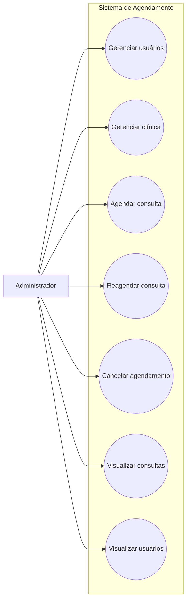

# Casos de Uso - Administrador

Este diagrama representa as interações do administrador com o sistema de agendamento.

## Casos de uso
- Gerenciar usuários
- Gerenciar clínica
- Agendar consulta
- Reagendar consulta
- Cancelar agendamento
- Visualizar consultas
- Visualizar usuários

## Diagrama

