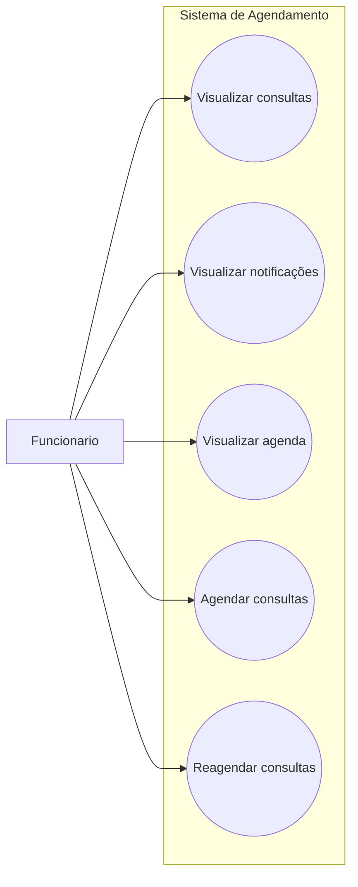

# Casos de Uso - Funcionário

Este diagrama representa as interações do funcionário com o sistema de agendamento.

## Casos de uso
- Visualizar consultas
- Visualizar notificações
- Visualizar agenda
- Agendar consultas
- Reagendar consultas

## Diagrama

