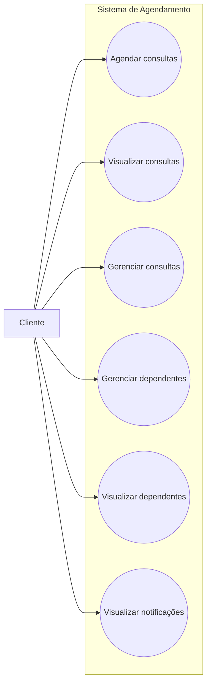

# Casos de Uso - Paciente

Este diagrama representa as interações do cliente com o sistema de agendamento.

## Casos de uso
- Agendar consultas 
- Visualizar consultas
- Gerenciar consultas  
- Gerenciar dependentes  
- Visualizar dependentes
- Visualizar notificações

## Diagrama

